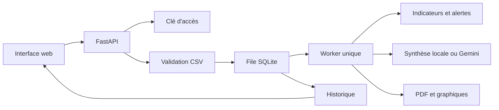

# Architecture

## Décisions

| Décision | Motivation |
| --- | --- |
| SQLite | Conserve l'historique et les tâches sans installer de serveur externe. |
| Worker unique | Matplotlib et ReportLab utilisent un état global ; les PDF sont produits de façon stable. |
| Clé Bearer locale | Protège les données et limite l'accès durant la démonstration. |
| Gemini optionnel | La démo reste utilisable sans clé ni envoi de données vers un service externe. |
| CSV strict | Un montant invalide ou un total incohérent bloque le rapport et indique la ligne concernée. |

## Cycle d'un rapport

1. L'utilisateur choisit le CSV et l'exercice.
2. L'API valide le fichier puis enregistre une tâche en attente.
3. Le worker lit le CSV, calcule les indicateurs, produit la synthèse et le PDF.
4. L'application conserve les indicateurs, alertes et métadonnées dans SQLite.
5. L'utilisateur consulte le rapport, télécharge le PDF ou compare N/N-1.

Les CSV importés sont supprimés après la génération. Les PDF restent disponibles
jusqu'à leur suppression manuelle depuis l'historique.
